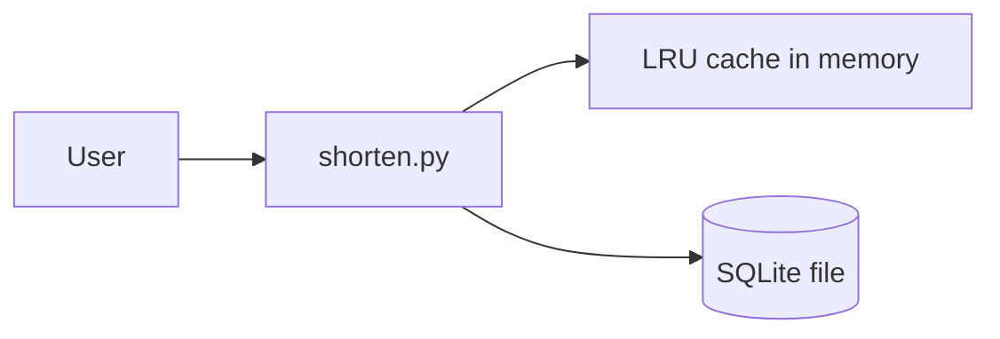
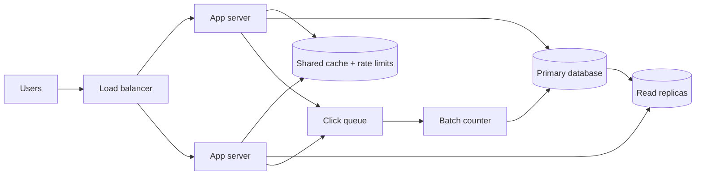

# What changes as traffic grows

This project runs on one machine. This note walks through what would
have to change at larger sizes. The numbers are rough estimates to
show the reasoning, not measurements.

## Today: one process, one file

Good for a personal tool or a small team.

## A rough size estimate

Suppose 1 million new links a month, each clicked 100 times.

- **Writes:** 1,000,000 / (30 days x 86,400 seconds) is about 0.4 per second.
- **Reads:** 100 times that, about 40 per second on average, with peaks
  several times higher.
- **Storage:** if a row takes about 500 bytes, a year of links is
  12,000,000 x 500 bytes = 6 GB.

So reads outnumber writes about 100 to 1, and the data is small. The
difficulty is serving reads quickly and staying available, not storing
the data.

## What breaks first, in order

| Step | What breaks | Change |
|---|---|---|
| 1 | One process can't handle the read peaks | Put a web server in front and run several copies behind a load balancer |
| 2 | SQLite allows one writer and lives on one machine | Move the table to Postgres (same schema) |
| 3 | Each server has its own cache and its own rate-limit counts | Move both to a shared store such as Redis |
| 4 | Every click writes to the main database | Send click events to a queue and count them in batches |
| 5 | The database can't keep up with reads | Add read replicas; lookups go to replicas, creates go to the primary |
| 6 | Users far away see slow redirects | Serve redirects from a CDN or regional servers |

## After those changes

## What stays the same

The four decisions survive every step: random codes with a uniqueness
check, a `code -> url` table, a cache in front of it, and a sliding
window on creation. Only where each piece lives changes.

## One thing a real service must add

Short links hide where they lead, which makes them useful for
phishing. A public shortener needs to check target URLs against
known-bad lists, show a preview option, and have a way to disable a
reported link.
